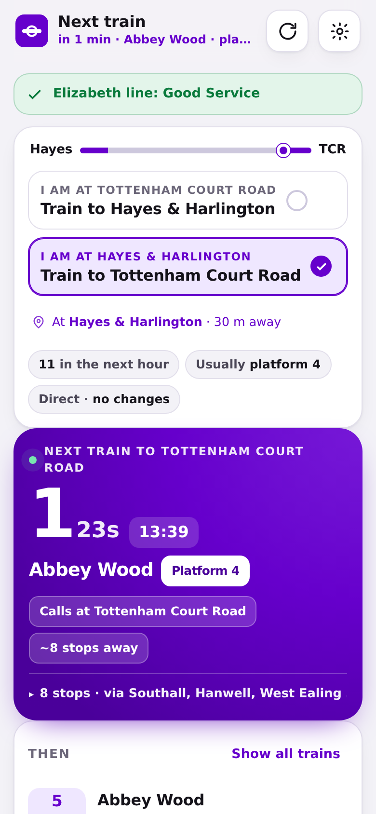
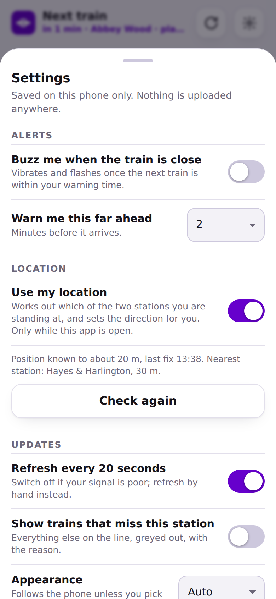

# Oli Commuter

An Elizabeth line departures board for the one journey that matters: **Tottenham Court Road
⇄ Hayes & Harlington**. Live times from Transport for London, no account, no tracking, and —
in the Android app — it opens on the right end of the platform because it knows which station
you are standing at.

| Opened on the platform at Hayes & Harlington | It explains itself in Settings |
|---|---|
|  |  |

## Install

Grab the newest `Oli-Commuter-debug.apk` from [Releases](../../releases) and put it on your
phone (cable, Files, email — whatever you already use). Tap it, allow *install from this app*
once when Android complains, tap it again. Android 7.0 or newer.

On first launch it asks for location: **While using the app**. Nothing else is needed — no
account, nothing running in the background.

It is a debug-signed build, which is the honest way to put your own app on your own phone.
If a previous "Next Elizabeth line" build is installed, uninstall it first: from 1.0.0 the app
id is `com.localtools.olicommuter`.

## What it does

- **The next train, unmissably big** — countdown, minutes, platform, destination, and whether
  it actually calls at the other station.
- **"Does it really stop there?"** answered properly. The app builds the line's stop graph from
  TfL's own route data and checks the path, rather than squinting at a destination name. A train
  going the right way with no confirmation of a call says exactly that, never "stops here".
- **Everything else on the line** is one tap away, greyed out, each with the reason it is
  useless to you.
- **Service problems** from TfL appear at the top as soon as they exist. The 20-second refresh
  can be paused; the board keeps the last real times and labels them as remembered rather than
  live if the signal drops.
- **Alerts** vibrate — and notify, if you allow it — when the next train is within your warning
  time.
- **Dark, light or automatic**, big tap targets, works on a small phone with one thumb.

## What the location is used for

One decision: which of the two stations you are standing at, so the direction sets itself.

- Only while the app is on screen. The watch stops the moment you leave it: no background
  service, no geofence, nothing listening.
- Inside 600 m it picks a direction. Further out it says *"Neither station is close · 9.1 km to
  TCR"* and leaves you the buttons.
- A direction you tap by hand is left alone for ten minutes even if the GPS disagrees, and the
  two buttons still work with location switched off entirely.
- Station coordinates come from TfL's own published route data and are cached on the phone. The
  comparing happens on the handset; the only network traffic is the same anonymous TfL API call
  the web page makes.

## Two ways to use it

`web/index.html` is the whole application: markup, styles and script in one file. Open it in a
browser and it works — from a web server, or straight off a memory stick. That is what the
Android app wraps, in a WebView, with the native geolocation plugin.

## Building

    npm install
    ./build.sh                    # -> build/Oli-Commuter-debug.apk

`build.sh` needs a JDK 21 and an Android SDK with platform 36 plus build-tools 36. It looks for
them in `../.android-tooling` (a folder with `jdk21/` and `sdk/`) and otherwise uses your
`JAVA_HOME` and `ANDROID_HOME`. It runs `npx cap sync android`, which copies `web/` into the
Android project, then `./gradlew assembleDebug`.

    npx cap open android          # the same project in Android Studio
    python3 make-icons.py         # redraws the roundel launcher icons, no image library needed

## Making a release

1. Put the new version in `package.json` and in `versionName` (and `versionCode`, one step up)
   in `android/app/build.gradle`, and add an entry to [`CHANGELOG.md`](CHANGELOG.md).
2. `./build.sh`, install it on the phone, check it.
3. `git commit -am "1.2.3: what changed" && git tag v1.2.3 && git push origin main --follow-tags`.

Pushing a `v*` tag runs [the APK workflow](.github/workflows/android.yml), which builds the
debug APK and attaches it to the release. If you add `KEYSTORE_BASE64`, `KEYSTORE_PASSWORD` and
`KEY_ALIAS` repository secrets, it also signs a proper release build with your own key and ships
that too.

## Layout

| Path | What it is |
|---|---|
| `web/index.html` | the entire app. Everything interesting happens here. |
| `capacitor.config.json` | app id, name, WebView settings. |
| `android/` | the generated Android project: manifest, Gradle, launcher icons. |
| `android/app/src/main/AndroidManifest.xml` | where the two location permissions live. |
| `build.sh`, `make-icons.py` | build the APK; draw the icons. |
| `docs/screenshots/` | pictures for this page. |

`android/app/src/main/assets/public/` is a copy of `web/` made by `cap sync`, so it is not in
git. The app talks to the phone through `window.Capacitor.Plugins.Geolocation` when it is there
and plain `navigator.geolocation` otherwise, which is why the same file works both as a web page
and inside the app.

## Credits

Live times, line status and station data are from [Transport for London](https://api.tfl.gov.uk)
and are shown as TfL reports them; TfL owns the Elizabeth line name and roundel. Maintained by
ViriatusOG. MIT licensed.
