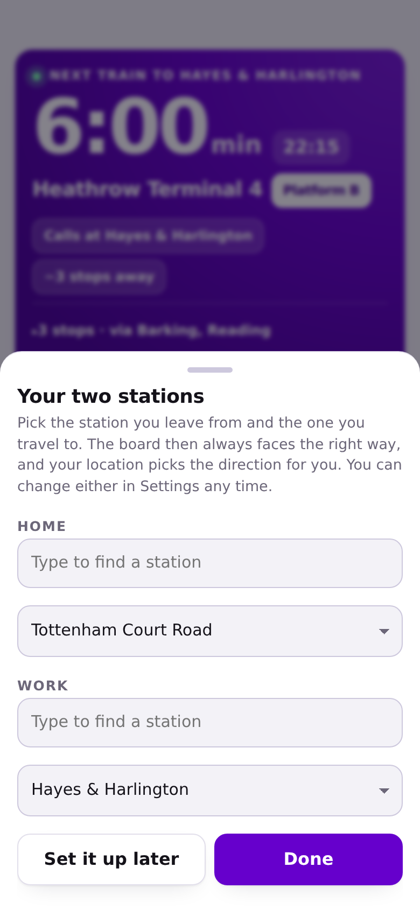
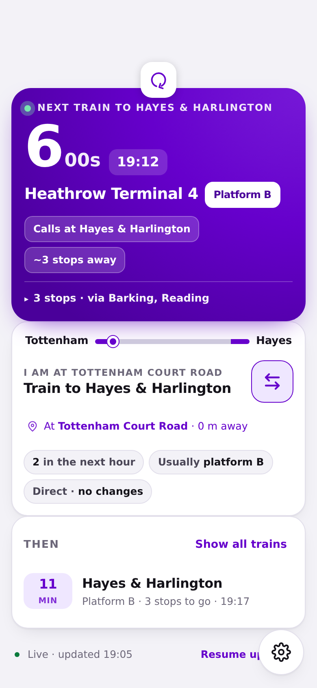
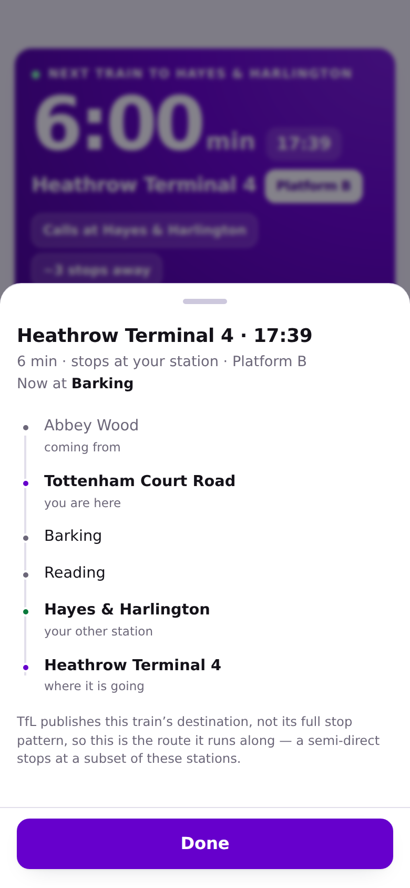
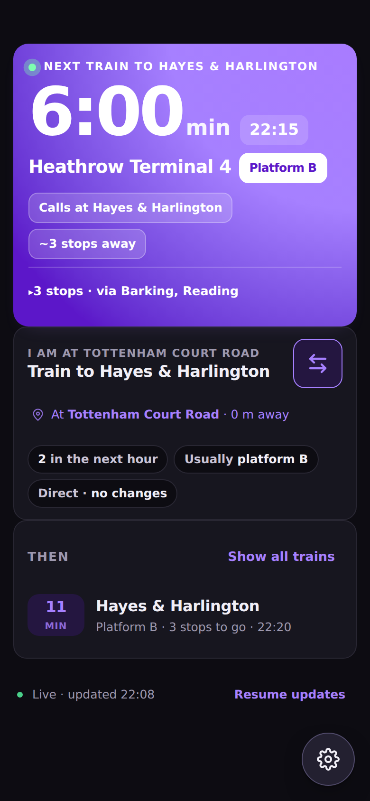
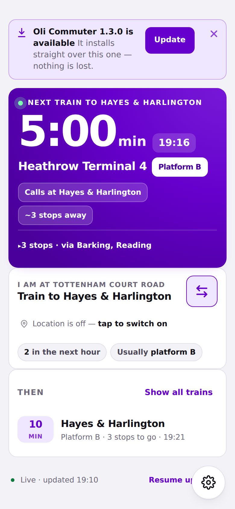

# Oli Commuter

An Elizabeth line departures board for the journey that matters — the one between **your two
stations**, the ones you mark as Home and Work. Live times from Transport for London,
no account, no tracking, and — in the Android app — it opens on the right end of the platform
because it knows which station you are standing at.

| Opened on the platform at Hayes & Harlington | First run: it asks which two stations are yours |
|---|---|
|  |  |
|  |  |
|  |  |
|  | |

## Install

Grab the newest `Oli-Commuter-debug.apk` from [Releases](../../releases) and put it on your
phone (cable, Files, email — whatever you already use). Tap it, allow *install from this app*
once when Android complains, tap it again. Android 7.0 or newer.

On first launch it asks two things: **which two stations are yours** (it guesses the classic
pair, you confirm or change in two taps) — it asks once and then leaves the pair to Settings —
and **location** (**While using the app**) so it knows which of the two you are standing at.
Nothing else is needed — no account, nothing running in the background.

From 1.3.0 an installed app updates itself from within (see above), so you only
need the first APK once.

It is a debug-signed build, which is the honest way to put your own app on your own phone.
If a previous "Next Elizabeth line" build is installed, uninstall it first: from 1.0.0 the app
id is `com.localtools.olicommuter`.

## What it does

- **Your two stations, Home and Work.** First run asks for them once; after that the whole
  board faces the right way — next train to Work when you are at Home, the journey back when
  you are not. Either one is changed in Settings any time, and every station on the line is a
  valid pick, not just the two this app shipped with — and each picker has a find box that
  shows a tap-to-pick list as you type, so forty-odd stations is never an alphabet trudge.
- **The next train, unmissably big, and at the top.** Countdown, minutes, platform,
  destination, and whether it actually calls at the other station — the big card leads the
  screen and nothing else repeats it.
- **One row, one flip.** The journey card says where you are, where the trains go, and a single
  button flips the direction.
- **Updates itself.** The app checks the release feed while it is open,
  offers a new version as a banner, downloads it (progress included), verifies
  the published SHA-256 and hands it to Android's installer. You can also
  check by hand in Settings, and the old APK download still works if you ever
  want it. The banner shows the download's progress, can be dismissed until there is a
  newer version, and after an install the app greets you with what's new.
- **Tap any train to see its route.** A train you can tap — the big one or any row in the list —
  opens its path: where it is now, where it came from, every stop between you and the
  destination, and your stations marked. TfL publishes the destination but not each train's full
  stop pattern, so the sheet says exactly that when a semi-direct stops at a subset of the route.
- **"Does it really stop there?"** answered properly. The app builds the line's stop graph from
  TfL's own route data and checks the path, rather than squinting at a destination name. A train
  going the right way with no confirmation of a call says exactly that, never "stops here".
- **Everything else on the line** is one tap away, greyed out, each with the reason it is
  useless to you.
- **Line status you can read at a glance.** A small green "All good" pill when the line is
  fine; amber when there is a problem on the line; red, with an *on your route* badge, when the
  problem hits your two stations. The 20-second refresh can be paused; the board keeps the last
  real times and labels them as remembered rather than live if the signal drops.
- **Alerts** buzz once when the next train is within your warning time, while the app is on
  screen.
- **One-handed by design.** One button on screen, where your thumb already is: Settings.
  Refreshing is a gesture, not a button. Light, dark or match-the-system appearance is a setting
  in Settings, not a button to hunt for.
- **Pull to refresh.** Grab the board at the top and drag down, like every other app on
  your phone.
- **Back always does the obvious thing.** Back (or Escape) closes the route sheet, setup or
  Settings — whichever is on top — and only leaves the app when there is nothing left to
  close. Every sheet also ends in a Done button, and once the big card scrolls away the
  countdown lives on as a slim bar at the top of the screen.

## What the location is used for

One decision: which of *your* two stations you are standing at, so the direction sets itself.

- Only while the app is on screen. The watch stops the moment you leave it: no background
  service, no geofence, nothing listening.
- Inside 600 m it picks a direction. Further out it says *"Neither station is close · 9.1 km to
  TCR"* and leaves you the buttons.
- A direction you flip by hand is left alone for ten minutes even if the GPS disagrees, and the
  flip button still works with location switched off entirely.
- Station coordinates come from TfL's own published route data and are cached on the phone. The
  comparing happens on the handset; the only network traffic is the same anonymous TfL API call
  the web page makes.

## Two ways to use it

`web/index.html` is the whole application: markup, styles and script in one file. Open it in a
browser and it works — from a web server, or straight off a memory stick. That is what the
Android app wraps, in a WebView, with the native geolocation plugin.

## Building

    npm install
    ./build.sh                    # -> build/Oli-Commuter-debug.apk

`build.sh` needs a JDK 21 and an Android SDK with platform 36 plus build-tools 36. It looks for
them in `../.android-tooling` (a folder with `jdk21/` and `sdk/`) and otherwise uses your
`JAVA_HOME` and `ANDROID_HOME`. It runs `npx cap sync android`, which copies `web/` into the
Android project, then `./gradlew assembleDebug`.

    npx cap open android          # the same project in Android Studio
    python3 make-icons.py         # redraws the roundel launcher icons, no image library needed

## Making a release

1. Put the new version in `package.json` and in `versionName` (and `versionCode`, one step up)
   in `android/app/build.gradle`, and add an entry to [`CHANGELOG.md`](CHANGELOG.md).
2. `./build.sh`, install it on the phone, check it.
3. `git commit -am "1.3.0: what changed" && git tag v1.3.0 && git push origin main --follow-tags`.

Pushing a `v*` tag runs [the APK workflow](.github/workflows/android.yml), which builds the
debug APK and attaches it to the release. If you add `KEYSTORE_BASE64`, `KEYSTORE_PASSWORD` and
`KEY_ALIAS` repository secrets, it also signs a proper release build with your own key and ships
that too.

## Layout

| Path | What it is |
|---|---|
| `web/index.html` | the entire app. Everything interesting happens here. |
| `capacitor.config.json` | app id, name, WebView settings. |
| `android/` | the generated Android project: manifest, Gradle, launcher icons. |
| `plugins/update/` | the small in-app update plugin: download, checksum, install intent. |
| `android/app/src/main/AndroidManifest.xml` | where the two location permissions live. |
| `build.sh`, `make-icons.py` | build the APK; draw the icons. |
| `docs/screenshots/` | pictures for this page. |

`android/app/src/main/assets/public/` is a copy of `web/` made by `cap sync`, so it is not in
git. The app talks to the phone through `window.Capacitor.Plugins.Geolocation` when it is there
and plain `navigator.geolocation` otherwise, which is why the same file works both as a web page
and inside the app.

## Credits

Live times, line status and station data are from [Transport for London](https://api.tfl.gov.uk)
and are shown as TfL reports them; TfL owns the Elizabeth line name and roundel. Maintained by
ViriatusOG. MIT licensed.
